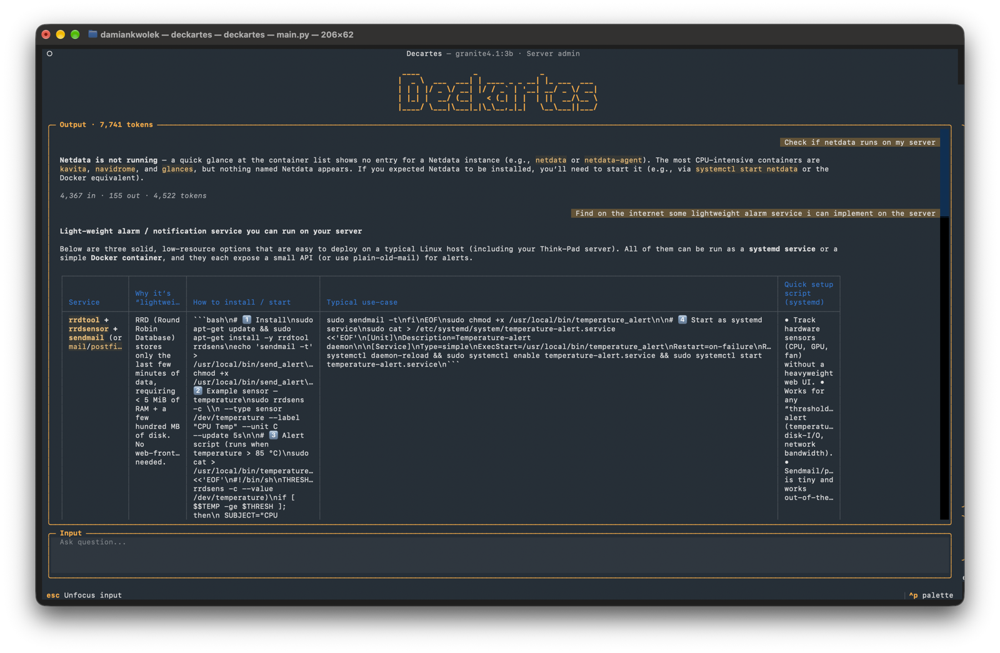

# Deckartes

<p align="center">
  
</p>
<p align="center">
  
  
</p>

A terminal chat app ([Textual](https://textual.textualize.io/)) for local MLX models on Apple Silicon, served by [Rapid-MLX](https://github.com/raullenchai/Rapid-MLX), with tools the model can call:

- **Home server**: CPU, RAM, disk, temperatures and Docker containers of the home server (through its Glances API).
- **This computer**: list folders, find files, folder sizes.
- **Web**: search and read pages through Ollama's web API.
- **Anime**: seasons, ratings, airing schedule and your own list, from AnimeSchedule.net.
- **Counter-Strike**: teams, players, matches and tournaments from PandaScore, and Valve's ranking.
- **Your files**: save text files, PDFs or whole folders from the file explorer (`e`) once, and ask about them in any session.
- **Calendar**: read and search your Apple Calendar and add events (you confirm each one), e.g. an anime episode or a CS match.

## TODO

- [ ] **Model routing**: pick a model per question, e.g. a small local one for chit-chat and a bigger one for hard questions.
- [x] **RAG over your documents**: a library of saved files and folders, searched with embeddings.
- [ ] **More documents**: several files at once, other formats (`.docx`), and a `/load <path>` command.
- [ ] **Vector DB**: store embeddings for documents, and later images and videos (LanceDB is the current pick).
- [ ] **Fine-tuning**: tune the model on this app's tools, starting with a test set and turn logging (plan in [FINE-TUNING.md](FINE-TUNING.md)).

## Setup

Requirements:

- Python 3.11+
- An Apple Silicon Mac with [Rapid-MLX](https://github.com/raullenchai/Rapid-MLX) installed. The app starts its servers and stops them on exit, and the models download the first time they're needed:

  ```bash
  uv tool install 'rapid-mlx[embeddings]'
  ```

- For the server tools: [Glances](https://nicolargo.github.io/glances/) running in web server mode on the home server (default `http://thinkpad:61208`).

Install the dependencies into a virtual environment (there is no requirements file yet):

```bash
python3 -m venv venv
venv/bin/pip install textual textual-dev httpx pyobjc-framework-EventKit pypdf cryptography numpy
```

The calendar tools use macOS's EventKit and see every calendar synced to Calendar.app (iCloud, Google, Exchange). The first calendar question shows a macOS prompt asking to give your terminal app (Terminal, iTerm, VS Code) access to your calendars. You can change that later in System Settings > Privacy & Security > Calendars.

API keys go in a `.env` file next to `config.py`, or in the environment:

```bash
OLLAMA_API_KEY=...          # web search and page reading
ANIMESCHEDULE_TOKEN=...     # anime tools (animeschedule.net application token)
PANDA_SCORE_API_TOKEN=...   # Counter-Strike tools (pandascore.co, the free plan works)
```

A tool whose key is missing returns an error to the model; everything else keeps working.

## Running

```bash
venv/bin/python main.py
```

To see logs, run with devtools and open the console in a second terminal:

```bash
venv/bin/textual run --dev main.py
venv/bin/textual console
```

### From your phone (Telegram)

Deckartes can also answer through a Telegram bot while the Mac runs it. Create a bot with @BotFather, add these to `.env`, and open `deckartes-telegram.command`:

```bash
TELEGRAM_BOT_TOKEN=...      # from @BotFather
TELEGRAM_USER_ID=...        # your numeric Telegram id; nobody else gets an answer
```

It has to run from Terminal, because background services are refused calendar access. Add the file to Login Items to start it at login. Telegram bot chats aren't end-to-end encrypted, so questions and replies pass through Telegram's servers. See [docs/telegram.md](docs/telegram.md).

### Keys and commands

| Key | Action |
|---|---|
| `Enter` | Send the message |
| `Esc` | Leave the input box, so the single-key shortcuts below work |
| `c` | Settings: system prompt preset, temperature, context limit |
| `m` | Change model |
| `e` | File explorer: browse the home folder (hidden files left out), with sizes of the highlighted file or folder. `Enter` on a file or `l` on a file or folder saves it to the library (see [Saving files to the library](#saving-files-to-the-library)) |
| `t` | Show or hide token usage (per reply, and the total in the Output title) |
| `h` | Help |
| `q` | Quit |
| `ctrl+c` | Stop the reply being generated, or copy selected text |

Typed into the input box:

| Command | Action |
|---|---|
| `/clear` | Clear the conversation |
| `/kill` | Stop the model servers to free their memory; the next question starts them again |
| `/library` | List the files saved in the library |
| `/forget <path or file name>` | Remove saved files from the library |
| `/validate` | Score the loaded model's tool use on the validation cases |

Select text with the mouse and press `ctrl+c` to copy it.

## Configuration

Settings live in `config.py`, as fields of the shared `config` object. The settings popup (`c`) and the model picker (`m`) change some of them while the app runs. Others are changed by editing the file.

| Setting | Default | What it does |
|---|---|---|
| `host` | `http://127.0.0.1:8000` | Chat server the app starts |
| `file_embed_host` | `http://127.0.0.1:8001` | Embeddings-only server, started when the library is used |
| `mlx_server_command` | `~/.local/bin/rapid-mlx` | The Rapid-MLX program |
| `model` | `LiquidAI/LFM3-1.7B-MLX-4bit` | Chat model (also changed with `m`, which restarts the server) |
| `context_length` | `16384` | The app's budget in tokens, for deciding when to compact. Chosen with `c` from `CONTEXT_LENGTHS` in `config.py`: 2K, 4K, 8K, 16K or 32K |
| `max_tokens` | `4096` | Longest reply in tokens |
| `enable_thinking` | `False` | Let the model reason before answering, which is slower |
| `temperature`, `top_k`, `repetition_penalty` | `0.1`, `50`, `1.1` | Sampling, LFM3's recommended chat settings. `None` uses the model's default. Temperature is also changed with `c` |
| `system_prompt` | `Assistant` | Preset from `prompts.json` (also changed with `c`) |
| `tool_routing` | `True` | Send only the tool groups a question needs (see [Tool routing](#tool-routing)) |
| `embed_model` | `mlx-community/all-MiniLM-L6-v2-4bit` | Embedding model used for tool routing |
| `rag_embed_model` | `mlx-community/embeddinggemma-2-4bit` | Embedding model for the library (multilingual) |
| `library_path` | `~/.local/share/deckartes/library.db` | Where saved files are kept |
| `show_token_usage` | `False` | Show token counts (toggled with `t`) |
| `glances_host` | `http://thinkpad:61208` | Glances API of the home server |
| `timezone` | this machine's | Used for "today" and all displayed times |
| `animeschedule_user` | `SeggyX` | Whose public anime list the list tool reads |
| `anime_air_type` | `sub` | Timetable to follow: `sub`, `raw` or `dub` |
| `anime_min_rating` | `6.0` | Anime rated at or below this (0–10) are left out; unrated ones are kept |
| `calendar_name` | `""` | Calendar that new events go to. Empty uses the default calendar from Calendar's settings |
| `cs_min_tier` | `b` | "All matches" CS lists keep events of this PandaScore tier or better (`s`, `a`, `b`, `c`, `d`), plus any match of a team in Valve's top 30 |
| `ollama_api_key`, `animeschedule_token`, `pandascore_token` | from `.env` | API keys, read from the environment or `.env` |

### Prompt presets

`prompts.json` holds the system prompt presets you can pick with `c`. Each has a name, a description, the prompt text and the tools it may use (`"all"`, a list of tool names, or `[]` for none). The file is re-read on every message, so edits apply without a restart. The current date is always added in front of the prompt and the time just before each question, so presets don't need to mention them.

| Preset | Tools |
|---|---|
| Assistant | All |
| Server admin | Home server |
| Anime guide | Anime, web |
| CS esports | Counter-Strike, web |
| Planner | Calendar, plus the anime and CS tools for adding episodes and matches |
| File finder | This computer |
| Researcher | Web |
| Chat only | None |

## Adding a tool

A tool is an async function in `tools.py`. `tool_schema.py` builds the definition the model sees from the function's name, type hints and docstring, so these are what tell the model when and how to use it.

### 1. Write the function

```python
async def get_exchange_rate(base: str, target: str) -> str:
    """Get today's exchange rate between two currencies, e.g. how many PLN one EUR buys.

    Args:
        base: Currency to convert from, as a 3-letter code, e.g. "EUR"
        target: Currency to convert to, as a 3-letter code, e.g. "PLN"
    """
    rate = await currency.rate(base.upper(), target.upper())
    return f"1 {base.upper()} = {rate:.4f} {target.upper()} (today's rate)"
```

Guidelines:

- **Google-style docstring with an `Args:` section.** Say what the tool returns and when to use it. For the server and disk tools, say "home server (thinkpad)" or "this computer", so the model can tell them apart.
- **Keep parameters few.** Every parameter is marked as required, even ones with defaults.
- **One tool per common question.** A tool that answers "when does X air next" directly is better than one the model has to call day by day. Small models don't chain tools reliably.
- **Return short plain text, not raw API JSON.** One line per item, readable units (GB, %, °C, local times), shared context stated once in a header, and no `null` fields. It costs about half the tokens, and small models misread raw values such as byte counts. Strings are passed to the model as they are; anything else is JSON-encoded.
- **Include the reference values the model would otherwise guess,** such as limits, totals or "this week ends Sunday". When a small model can't find something in a result, it makes it up.
- **Say explicitly when nothing is found**, e.g. `"No team found with that name."`, never an empty list.
- **Cap the size of what you return** (see `MAX_PAGE_CHARS`), so results fit in the context window.
- **Raise exceptions for errors.** `run_tool` turns them into a message for the model, so it can tell the user what went wrong.
- **Run blocking work with `asyncio.to_thread`.**
- **Ask before changing anything outside the app.** Call `await confirm("...?")` from `tools.py` first: it shows a yes/no popup and returns the answer (see `add_calendar_event`).

Calls to an outside API belong in their own module (like `cs_api.py` or `glances_api.py`), with the tool in `tools.py` as a thin wrapper. Read API keys from `config`, and add them to `config.py` with `read_env("YOUR_KEY_NAME")`.

### 2. Register it

Add the function to the `TOOLS` list in `tools.py`.

### 3. Put it in a routing group

Add the tool's name to a group in `TOOL_GROUPS` (in `tools.py`), or create a new group with 7–10 example questions:

```python
"money": {
    "tools": ["get_exchange_rate"],
    "examples": [
        "How much is 100 euro in zloty?", "What's the dollar exchange rate?",
        "Convert 50 USD to PLN", "Is the euro stronger than last week?",
        # ...questions phrased the way you'd actually ask them
    ],
},
```

A tool that's in no group is sent with every question, which works but costs tokens.

### 4. Add it to the presets

Add the tool's name to the `tools` list of each preset in `prompts.json` that should be able to use it. Presets with `"tools": "all"` get it automatically.

### 5. Try it

Ask a few questions the way you normally would, with `t` on. The usage line shows which tool groups were sent ("tools: money"). If the tool doesn't get picked, add an example question similar to yours to its group.

## Tool routing

Tool definitions are most of what's sent with a short question: about 2,700 tokens for all tools, against 90 for "hi" without them. Before each question, `tool_router.py` embeds it with `embed_model` and compares it with each group's example questions, plus a set of questions that need no tools:

- **Groups that clearly match** are sent, for example only the CS tools for "who's the best CS team?".
- **Small talk** ("thanks!", "tell me a joke") gets no tools.
- **Vague follow-ups** ("and Vitality?") use the previous question's topic.
- **Unsure questions** get the two closest groups.

If the embedding model isn't available, every tool the preset allows is sent. The thresholds were checked with `all-MiniLM-L6-v2`, so a different embedding model may need new ones. To fix a question that gets routed wrong, add an example to the right group rather than lowering thresholds.

## Saving files to the library

Press `e` and pick what to save: `Enter` on a text file (notes, markdown, code, CSV...) or PDF, or `l` on a file or a whole folder. Saved files stay in the library (`~/.local/share/deckartes/library.db`) between sessions, so each file only has to be loaded once, and the model searches them with the `search_library` tool when a question is about your documents. Answers name the file and the page or line.

- **Loading the same file again** overwrites its old data. Other saved files aren't touched. A file that hasn't changed is skipped, so loading a folder again only embeds what's new or changed.
- **Folders** are read with their subfolders, keeping text, code and PDF files and leaving out hidden files, `node_modules` and virtual environments. Files that can't be read are named when the load ends.
- **Embedding** takes about 15 s per 100 chunks of about 1,500 characters. The spinner shows progress and the input is hidden until it ends. `ctrl+c` stops it, and files already finished stay saved.
- **`/library`** lists what's saved, and **`/forget <path or file name>`** removes a file or everything under a folder after asking. A file deleted from disk stays saved until you forget it.

Presets without the `search_library` tool, such as `Chat only`, can't see the library. PDFs need a text layer; scanned pages can't be read. Encrypted PDFs open if they have no password (most only restrict printing or copying); password-protected ones can't be loaded.

Small models sometimes answer from their own knowledge instead of the passages, or name the wrong lines, so check an answer that matters against the file.

## Project layout

| File | What's in it |
|---|---|
| `main.py` | Entry point |
| `app.py` | The app: key bindings, model picker, help screen |
| `chat.py` | Chat widgets: messages, spinner, commands, interrupting |
| `config_screen.py` | Settings popup |
| `file_explorer.py` | File explorer popup |
| `library.py` | The library of saved files: reading, chunking, embedding, storing and searching them |
| `chat.tcss` | Styles |
| `telegram_bot.py`, `telegram_api.py`, `deckartes-telegram.command` | The Telegram bot, its Bot API calls and its launcher |
| `conversation.py` | Conversation history, turns, the tool-calling loop and token counting, no UI |
| `mlx_client.py` | Chat, embeddings and the model list from the Rapid-MLX servers |
| `mlx_server.py` | Starting and stopping the Rapid-MLX servers |
| `tool_schema.py` | Builds the definition the model sees for each tool |
| `tool_router.py` | Picks which tool groups to send with a question |
| `tools.py` | Tool functions, `TOOLS` and `TOOL_GROUPS` |
| `prompts.py`, `prompts.json` | System prompt presets |
| `config.py` | Settings |
| `glances_api.py`, `disk_scan.py`, `web_search.py`, `animeschedule_api.py`, `cs_api.py`, `calendar_api.py` | Tool backends |

`CLAUDE.md` has more detail on how the parts fit together and why some things are done the way they are.
