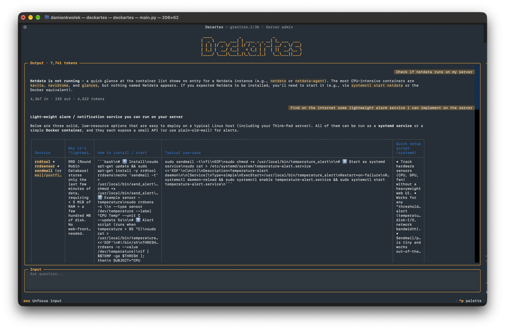
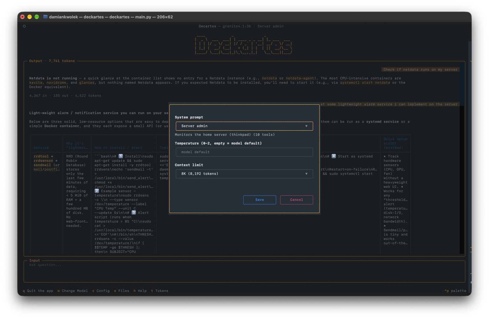
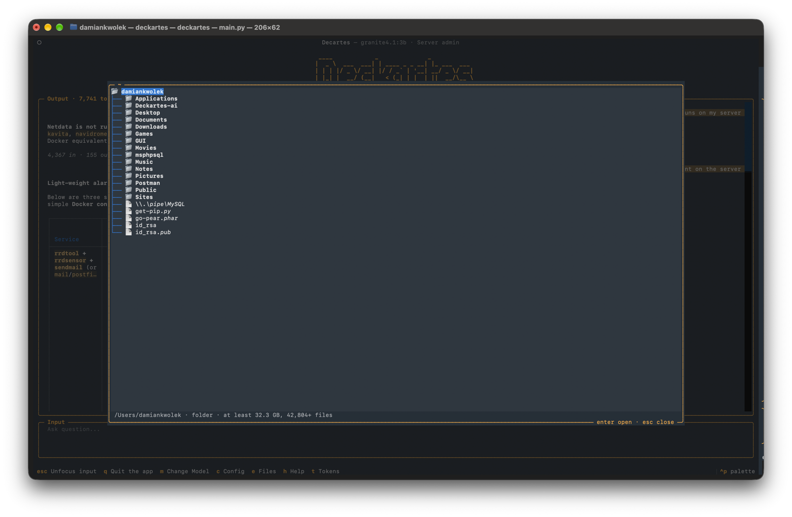

# Deckartes

<p align="center">
  
</p>
<p align="center">
  
  
</p>

A terminal chat app ([Textual](https://textual.textualize.io/)) for local [Ollama](https://ollama.com/) models, with tools the model can call:

- **Home server**: CPU, RAM, disk, temperatures and Docker containers of the home server (through its Glances API).
- **This computer**: list folders, find files, folder sizes.
- **Web**: search and read pages through Ollama's web API.
- **Anime**: seasons, ratings, airing schedule and your own list, from AnimeSchedule.net.
- **Counter-Strike**: teams, players, matches and tournaments from PandaScore, and Valve's ranking.
- **Your files**: load a text file or PDF from the file explorer (`e`) and ask about it. Long files are searched, so only the relevant parts are sent.
- **Calendar**: read and search your Apple Calendar and add events (you confirm each one), e.g. an anime episode or a CS match.

## TODO

- [x] **Cloud models**: use Ollama cloud models next to local ones (token usage display is ready, key `t`).
- [ ] **Model routing**: pick a model per question, e.g. a small local one for chit-chat and a bigger one for hard questions.
- [x] **RAG over one document**: load a file from the file explorer; long ones are searched with embeddings.
- [ ] **More documents**: several files at once, other formats (`.docx`), and a `/load <path>` command.
- [ ] **Vector DB**: store embeddings for documents, and later images and videos (LanceDB is the current pick).

## Setup

Requirements:

- Python 3.11+
- Ollama running on `localhost:11434`, with a chat model that supports tools (default `granite4.1:3b`) and the embedding model used for tool routing:

  ```bash
  ollama pull granite4.1:3b
  ollama pull all-minilm:33m
  ollama pull embeddinggemma-2:570m   # for searching long loaded files
  ```

- For the server tools: [Glances](https://nicolargo.github.io/glances/) running in web server mode on the home server (default `http://thinkpad:61208`).

Install the dependencies into a virtual environment (there is no requirements file yet):

```bash
python3 -m venv venv
venv/bin/pip install textual textual-dev ollama httpx pyobjc-framework-EventKit pypdf cryptography
```

The calendar tools use macOS's EventKit and see every calendar synced to Calendar.app (iCloud, Google, Exchange). The first calendar question shows a macOS prompt asking to give your terminal app (Terminal, iTerm, VS Code) access to your calendars. You can change that later in System Settings > Privacy & Security > Calendars.

API keys go in a `.env` file next to `config.py`, or in the environment:

```bash
OLLAMA_API_KEY=...          # web search and page reading
ANIMESCHEDULE_TOKEN=...     # anime tools (animeschedule.net application token)
PANDA_SCORE_API_TOKEN=...   # Counter-Strike tools (pandascore.co, the free plan works)
```

A tool whose key is missing returns an error to the model; everything else keeps working.

## Running

```bash
venv/bin/python main.py
```

To see logs, run with devtools and open the console in a second terminal:

```bash
venv/bin/textual run --dev main.py
venv/bin/textual console
```

### Keys and commands

| Key | Action |
|---|---|
| `Enter` | Send the message |
| `Esc` | Leave the input box, so the single-key shortcuts below work |
| `c` | Settings: system prompt preset, temperature, context limit |
| `m` | Change model |
| `e` | File explorer: browse the home folder (hidden files left out), with sizes of the highlighted file or folder. `Enter` on a file loads it into the chat (see [Loading a file](#loading-a-file)) |
| `t` | Show or hide token usage (per reply, and the total in the Output title) |
| `h` | Help |
| `q` | Quit |
| `ctrl+c` | Stop the reply being generated, or copy selected text |

Typed into the input box:

| Command | Action |
|---|---|
| `/clear` | Clear the conversation |
| `/kill` | Release all Ollama models from memory |
| `/unload` | Stop sending the file loaded with the file explorer |

Select text with the mouse and press `ctrl+c` to copy it.

## Configuration

Settings live in `config.py`, as fields of the shared `config` object. The settings popup (`c`) and the model picker (`m`) change some of them while the app runs. Others are changed by editing the file.

| Setting | Default | What it does |
|---|---|---|
| `host` | `http://localhost:11434` | Ollama server |
| `model` | `granite4.1:3b` | Chat model (also changed with `m`) |
| `context_length` | `16384` | Context window in tokens, sent to Ollama as `num_ctx` (Ollama's own default of 4096 is too small for tool results). Chosen with `c` from `CONTEXT_LENGTHS` in `config.py`: 2K, 4K, 8K, 16K or 32K |
| `temperature` | `None` | Sampling temperature. `None` uses the model's default |
| `system_prompt` | `Assistant` | Preset from `prompts.json` (also changed with `c`) |
| `tool_routing` | `True` | Send only the tool groups a question needs (see [Tool routing](#tool-routing)) |
| `embed_model` | `all-minilm:33m` | Embedding model used for tool routing |
| `rag_embed_model` | `embeddinggemma-2:570m` | Embedding model for searching long loaded files (multilingual) |
| `show_token_usage` | `False` | Show token counts (toggled with `t`) |
| `glances_host` | `http://thinkpad:61208` | Glances API of the home server |
| `timezone` | this machine's | Used for "today" and all displayed times |
| `animeschedule_user` | `SeggyX` | Whose public anime list the list tool reads |
| `anime_air_type` | `sub` | Timetable to follow: `sub`, `raw` or `dub` |
| `anime_min_rating` | `6.0` | Anime rated at or below this (0–10) are left out; unrated ones are kept |
| `calendar_name` | `""` | Calendar that new events go to. Empty uses the default calendar from Calendar's settings |
| `cs_min_tier` | `b` | "All matches" CS lists keep events of this PandaScore tier or better (`s`, `a`, `b`, `c`, `d`), plus any match of a team in Valve's top 30 |
| `ollama_api_key`, `animeschedule_token`, `pandascore_token` | from `.env` | API keys, read from the environment or `.env` |

### Prompt presets

`prompts.json` holds the system prompt presets you can pick with `c`. Each has a name, a description, the prompt text and the tools it may use (`"all"`, a list of tool names, or `[]` for none). The file is re-read on every message, so edits apply without a restart. The current date and time are always added in front of the prompt, so presets don't need to mention them.

| Preset | Tools |
|---|---|
| Assistant | All |
| Server admin | Home server |
| Anime guide | Anime, web |
| CS esports | Counter-Strike, web |
| Planner | Calendar, plus the anime and CS tools for adding episodes and matches |
| File finder | This computer |
| Researcher | Web |
| Chat only | None |

## Adding a tool

A tool is an async function in `tools.py`. Ollama builds the definition the model sees from the function's name, type hints and docstring, so these are what tell the model when and how to use it.

### 1. Write the function

```python
async def get_exchange_rate(base: str, target: str) -> str:
    """Get today's exchange rate between two currencies, e.g. how many PLN one EUR buys.

    Args:
        base: Currency to convert from, as a 3-letter code, e.g. "EUR"
        target: Currency to convert to, as a 3-letter code, e.g. "PLN"
    """
    rate = await currency.rate(base.upper(), target.upper())
    return f"1 {base.upper()} = {rate:.4f} {target.upper()} (today's rate)"
```

Guidelines:

- **Google-style docstring with an `Args:` section.** Say what the tool returns and when to use it. For the server and disk tools, say "home server (thinkpad)" or "this computer", so the model can tell them apart.
- **Keep parameters few.** Ollama marks every parameter as required, even ones with defaults.
- **One tool per common question.** A tool that answers "when does X air next" directly is better than one the model has to call day by day. Small models don't chain tools reliably.
- **Return short plain text, not raw API JSON.** One line per item, readable units (GB, %, °C, local times), shared context stated once in a header, and no `null` fields. It costs about half the tokens, and small models misread raw values such as byte counts. Strings are passed to the model as they are; anything else is JSON-encoded.
- **Include the reference values the model would otherwise guess,** such as limits, totals or "this week ends Sunday". When a small model can't find something in a result, it makes it up.
- **Say explicitly when nothing is found**, e.g. `"No team found with that name."`, never an empty list.
- **Cap the size of what you return** (see `MAX_PAGE_CHARS`), so results fit in the context window.
- **Raise exceptions for errors.** `run_tool` turns them into a message for the model, so it can tell the user what went wrong.
- **Run blocking work with `asyncio.to_thread`.**
- **Ask before changing anything outside the app.** Call `await confirm("...?")` from `tools.py` first: it shows a yes/no popup and returns the answer (see `add_calendar_event`).

Calls to an outside API belong in their own module (like `cs_api.py` or `glances_api.py`), with the tool in `tools.py` as a thin wrapper. Read API keys from `config`, and add them to `config.py` with `read_env("YOUR_KEY_NAME")`.

### 2. Register it

Add the function to the `TOOLS` list in `tools.py`.

### 3. Put it in a routing group

Add the tool's name to a group in `TOOL_GROUPS` (in `tools.py`), or create a new group with 7–10 example questions:

```python
"money": {
    "tools": ["get_exchange_rate"],
    "examples": [
        "How much is 100 euro in zloty?", "What's the dollar exchange rate?",
        "Convert 50 USD to PLN", "Is the euro stronger than last week?",
        # ...questions phrased the way you'd actually ask them
    ],
},
```

A tool that's in no group is sent with every question, which works but costs tokens.

### 4. Add it to the presets

Add the tool's name to the `tools` list of each preset in `prompts.json` that should be able to use it. Presets with `"tools": "all"` get it automatically.

### 5. Try it

Ask a few questions the way you normally would, with `t` on. The usage line shows which tool groups were sent ("tools: money"). If the tool doesn't get picked, add an example question similar to yours to its group.

## Tool routing

Tool definitions are most of what's sent with a short question: about 2,700 tokens for all tools, against 90 for "hi" without them. Before each question, `tool_router.py` embeds it with `embed_model` and compares it with each group's example questions, plus a set of questions that need no tools:

- **Groups that clearly match** are sent, for example only the CS tools for "who's the best CS team?".
- **Small talk** ("thanks!", "tell me a joke") gets no tools.
- **Vague follow-ups** ("and Vitality?") use the previous question's topic.
- **Unsure questions** get the two closest groups.

If the embedding model isn't available, every tool the preset allows is sent. The thresholds were tuned for `all-minilm`, so a different embedding model may need new ones. To fix a question that gets routed wrong, add an example to the right group rather than lowering thresholds.

## Loading a file

Press `e`, pick a text file (notes, markdown, code, CSV...) or a PDF and press `Enter`. The file's name appears in the Output title, and every question from then on comes with the file:

- **Short files** (up to a quarter of `context_length`, about 14,000 characters by default) are sent whole.
- **Longer files** are split into chunks of about 1,500 characters, which are embedded with `rag_embed_model` (about 15 s per 100 chunks; the spinner shows progress, `ctrl+c` stops it). Each question then gets the 5 chunks most like it, labelled with their lines or pages. The embeddings are cached in `~/.cache/deckartes/embeddings`, so loading the same file again is instant until it changes.

The file stays loaded until `/unload` or `/clear`. With `t` on, the usage line shows what was sent ("file: whole" or "file: 5 excerpts"). PDFs need a text layer; scanned pages can't be read. Encrypted PDFs open if they have no password (most only restrict printing or copying); password-protected ones can't be loaded.

Small models sometimes answer from their own knowledge instead of the file, or name the wrong lines. In tests, `granite4.1:3b` found the facts but sometimes cited the wrong lines or made up an answer for something the file doesn't contain; `qwen3.5:9B` got them all right, but took about 50 seconds per answer.

## Project layout

| File | What's in it |
|---|---|
| `main.py` | Entry point |
| `app.py` | The app: key bindings, model picker, help screen |
| `chat.py` | Chat widgets: messages, spinner, commands, interrupting |
| `config_screen.py` | Settings popup |
| `file_explorer.py` | File explorer popup |
| `rag.py` | Loading a file: reading, chunking, embedding and searching it |
| `chat.tcss` | Styles |
| `conversation.py` | Conversation history and turns, no UI |
| `ollama_api.py` | Model calls, the tool-calling loop, token counting |
| `tool_router.py` | Picks which tool groups to send with a question |
| `tools.py` | Tool functions, `TOOLS` and `TOOL_GROUPS` |
| `prompts.py`, `prompts.json` | System prompt presets |
| `config.py` | Settings |
| `glances_api.py`, `disk_scan.py`, `web_search.py`, `animeschedule_api.py`, `cs_api.py`, `calendar_api.py` | Tool backends |

`CLAUDE.md` has more detail on how the parts fit together and why some things are done the way they are.
