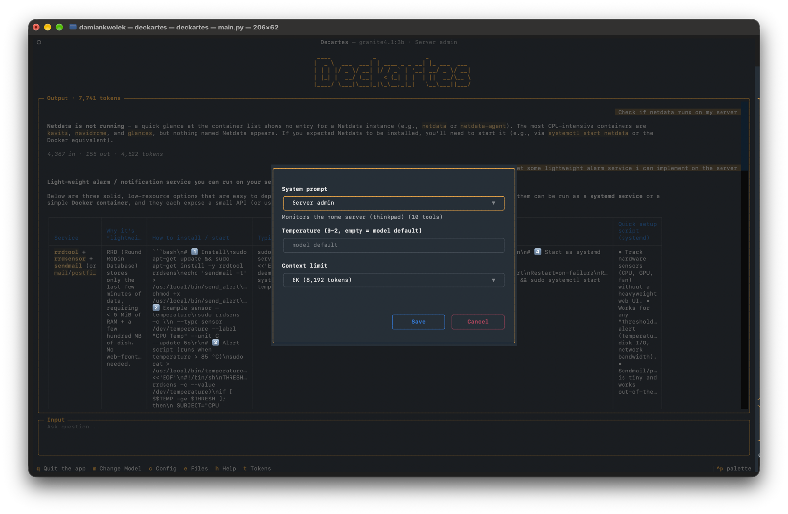
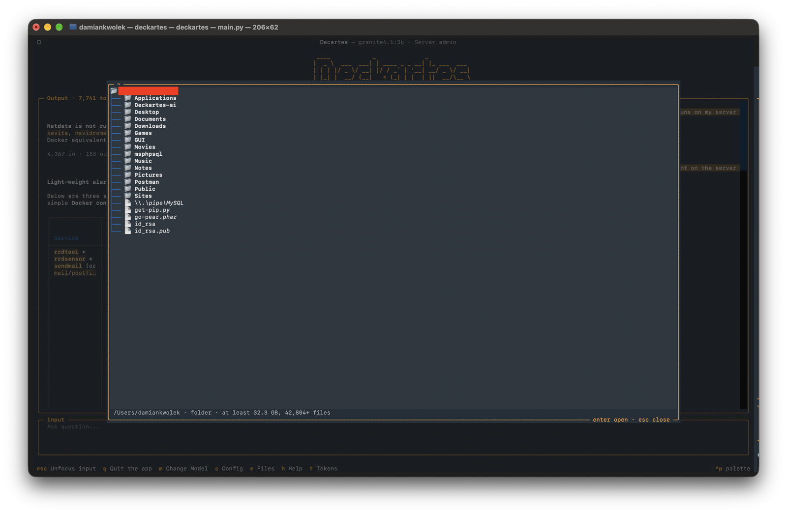

# Deckartes

<p align="center">
  
</p>
<p align="center">
  
  
</p>

A personal assistant that runs on your Mac, in the terminal or on your phone through Telegram.

## Philosophy

- **Local first.** The model runs on Apple Silicon with [Rapid-MLX](https://github.com/raullenchai/Rapid-MLX). Your questions and files stay on the Mac. Only tool calls to web APIs leave it.
- **Small model, good tools.** A 1.7B model doesn't know today's date, your server or your calendar. Tools give it fresh, short, plain-text facts, so it answers from data instead of guessing.
- **Only the tools a question needs.** A router picks the relevant tool groups per question, which keeps prompts short and choices easy for a small model.
- **You approve every change.** Anything that changes the world outside the app, like adding a calendar event, asks first.

## Overview

A chat app built with [Textual](https://textual.textualize.io/). The model can call tools for:

- **Home server:** CPU, RAM, disks, temperatures and Docker containers, through Glances.
- **This computer:** folders, file search, folder sizes.
- **Web:** search and page reading, through Ollama's web API.
- **Anime:** seasons, ratings, airing times and your list, from AnimeSchedule.net.
- **Counter-Strike:** teams, players, matches and Valve's ranking, from PandaScore.
- **Calendar:** read, search and add events in Apple Calendar.
- **Bank:** your transactions and spending per category, through Enable Banking.
- **Your files:** a library of saved documents, searched with embeddings.

Long conversations are summarised automatically when they near the context limit. Every tool group is optional: one without its key or service reports an error, and the rest keep working.

## TODO

[ ] Better RAG search (not just by embedded chunks)

[ ] Scanning folders on the home server

[ ] Prepare fine tuning data

[ ] Telegram: send files from the phone to the library (bots download up to 20 MB; files need a permanent inbox folder, since the library identifies them by path)

## Setup

You need an Apple Silicon Mac, Python 3.11+ and [uv](https://docs.astral.sh/uv/) (to install Rapid-MLX):

```bash
uv tool install 'rapid-mlx[embeddings]'
python3 -m venv venv
venv/bin/pip install textual textual-dev httpx pyobjc-framework-EventKit pypdf cryptography numpy \
  telegramify-markdown python-dotenv cachetools anyascii rapidfuzz docstring-parser tzlocal pyjwt ruff
```

The app starts the model servers itself and downloads models on first use. The spending categories use a separate decision model that you make once (about 1 GB); see [docs/model-server.md](docs/model-server.md).

Copy `.env.example` to `.env` and fill in the keys for the tools you want:

| Variable | Used by |
|---|---|
| `OLLAMA_API_KEY` | Web tools |
| `ANIMESCHEDULE_TOKEN` | Anime tools |
| `PANDA_SCORE_API_TOKEN` | Counter-Strike tools (the free plan works) |
| `ENABLE_BANKING_APP_ID`, `ENABLE_BANKING_KEY_PATH` | Bank tools; see [Bank](#bank) |
| `ENABLE_BANKING_SANDBOX_ID`, `ENABLE_BANKING_SANDBOX_KEY_PATH`, `ENABLE_BANKING_SANDBOX=1` | Optional: a sandbox bank app for testing |
| `TELEGRAM_BOT_TOKEN`, `TELEGRAM_USER_ID` | Telegram bot; see [Telegram](#telegram) |

The calendar tools ask macOS for calendar access on first use.

### Make it yours

Settings live in `src/core/config.py`. These ones depend on your setup:

| Setting | What to set |
|---|---|
| `glances_host` | Your server running [Glances](https://nicolargo.github.io/glances/) in web server mode (`glances -w`), e.g. `http://my-server:61208` |
| `animeschedule_user` | Your AnimeSchedule.net username; the list must be public |
| `enable_banking_redirect_url` | Where your bank sends you back after linking; see [Bank](#bank) |
| `calendar_name` | The calendar new events go to; `""` = your default calendar |
| `cs_min_tier`, `anime_air_type`, `anime_min_rating` | Which matches and anime count as worth showing |

The model, temperature and other chat settings are also there. The settings popup (`c`) and model picker (`m`) change some of them while the app runs. Every prompt the app sends a model is in `prompts.json` and is re-read on every message. The spending categories and their prompt are written in Polish, so translate them for your language.

## Usage

```bash
venv/bin/python src/main.py
```

| Key | Action |
|---|---|
| `Enter` | Send |
| `Esc` | Leave the input box, so the single-key shortcuts work |
| `c` | Settings: prompt, temperature, context limit |
| `m` | Change model |
| `e` | File explorer, to save files to the library |
| `r` | Saved conversations |
| `s` | Spending labels: review payee categories |
| `shift+t` | Detailed mode: thinking, tool calls and token usage |
| `h` | Help |
| `q` | Quit |
| `ctrl+c` | Stop the reply, or copy selected text |

| Command | Action |
|---|---|
| `/clear` | Clear the conversation |
| `/kill` | Stop the model servers to free memory |
| `/library` | List saved files |
| `/forget <path or name>` | Remove files from the library |
| `/validate` | Score the model's tool use on test cases |

## Library

Press `e`, then `Enter` on a file or `l` on a file or folder to save it. Text files, code and PDFs with a text layer work. Saved files stay between sessions, and answers name the file and the page or line.

Loading a folder again only embeds new or changed files. Small models sometimes answer from their own knowledge, so check answers that matter. Details: [docs/library.md](docs/library.md).

## Bank

Deckartes reads your bank transactions through [Enable Banking](https://enablebanking.com), read-only: it can't make payments. Setting it up takes two approvals at your bank: one activates the app, the other lets Deckartes read the accounts.

1. **Host the redirect page.** Enable Banking production apps need an https redirect URL that isn't localhost. Nothing runs there: `pages/callback/index.html` is a static page that shows the address you paste back into the terminal. The simplest host is GitHub Pages on your fork: set Settings > Pages > Source to *GitHub Actions*, and `.github/workflows/pages.yml` publishes `pages/` to `https://<your-user>.github.io/<your-repo>/`. Any other https host works too. Set `enable_banking_redirect_url` in `src/core/config.py` to the callback page's address.
2. **Register the app.** In the Enable Banking Control Panel, under API applications, add an application with environment **Production**. Set its redirect URL to exactly the address from step 1, and its privacy URL to the `privacy/` page next to it (`pages/privacy/index.html`; edit it if you change what the app reads).
3. **Save its key.** Put the downloaded `.pem` in `private/` (ignored by git) and add to `.env`:

   ```bash
   ENABLE_BANKING_APP_ID=<the application id>
   ENABLE_BANKING_KEY_PATH=private/<the key>.pem
   ```

4. **Activate it.** The new app is *Inactive*. Press **Activate by linking accounts**, log in to your bank and choose the accounts. The app is then in restricted mode: it reads only those accounts, which is all a personal app needs.
5. **Link Deckartes.** From `src/`:

   ```bash
   ../venv/bin/python -m tools.enable_banking_api
   ```

   Check it says *production app*, enter your country code (e.g. `DE`) and pick your bank's number. Open the link it prints, log in and approve the **same accounts** as in step 4. The bank sends you to the redirect page: press **Copy**, paste the address into the terminal, and it prints `Linked N accounts, valid until …`.

Then ask things like "what did I spend this week?". The bank's approval lasts up to 180 days (90 at some banks); with the Telegram bot set up, a message comes 7 days and 1 day before it ends, and step 5 renews it. To test with made-up banks, use a sandbox app: see [docs/tools-banking.md](docs/tools-banking.md).

## Telegram

A Telegram bot gives the same assistant on your phone. Create one with [@BotFather](https://t.me/BotFather) for `TELEGRAM_BOT_TOKEN`, and put your numeric Telegram user id in `TELEGRAM_USER_ID`: the bot answers only that user. It asks before calendar changes with Yes and No buttons.

Start it with `deckartes-telegram.command`, and add that file to System Settings > General > Login Items to start it at login. It must run from Terminal, because background services are refused calendar access.

Telegram chats aren't end-to-end encrypted, so questions and replies pass through Telegram's servers.

Separate morning jobs, run by launchd, send the day's anime episodes from your list, weekly and monthly spending digests, and a reminder before the bank link expires. `src/jobs/schedule.py` lists them and when they run; install them with:

```bash
(cd src && ../venv/bin/python -m jobs.schedule)
```

Details: [docs/telegram.md](docs/telegram.md).

## Tool routing

Tool definitions cost about 2,700 tokens per question. Before each question, the router compares it with example questions per tool group and sends only the groups that match. Small talk gets no tools, and vague follow-ups reuse the previous topic. To fix a wrong pick, add an example question to the right group. Details: [docs/tool-routing.md](docs/tool-routing.md).

## Development

```bash
PYTHONPATH=src venv/bin/python -m unittest discover tests   # tests
venv/bin/ruff check .                                       # lint
PYTHONPATH=src venv/bin/textual run --dev src/main.py       # with devtools; logs in `venv/bin/textual console`
```

Code lives in `src/`, one package per feature: `ui`, `agent`, `model`, `tools`, `telegram`, `core`, `validation` and `jobs`.

- Adding a tool: [docs/adding-a-tool.md](docs/adding-a-tool.md)
- Architecture: [CLAUDE.md](CLAUDE.md) and [docs/wiki.html](docs/wiki.html)
- Plans: [FINE-TUNING.md](FINE-TUNING.md)
